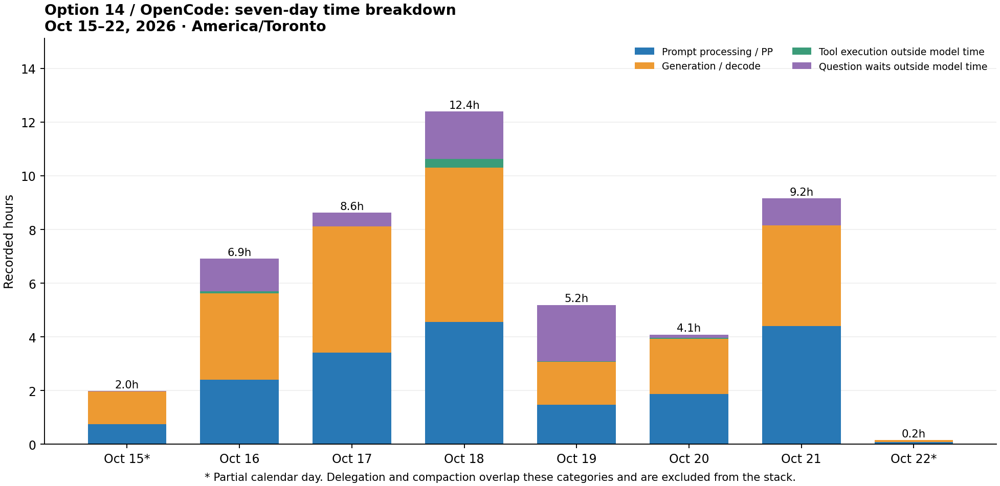

# Option 14 and OpenCode: seven-day time audit

Window: **2026-10-15 14:22:49 to 2026-10-22 14:22:49 America/Toronto** (rolling 168 hours). Five primary option-14 log files; isolated benchmark servers and other model profiles excluded. OpenCode journal events are reconciled with indexed, read-only session-database records.

**Model work dominates:** 18h 56m 48s in prompt processing and 22h 22m 04s in generation. Ordinary tool execution totals 30m 19s; question waits total 6h 44m 16s. Delegation and compaction are overlapping views, so they are shown separately.

| Recorded category | Time | Meaning / overlap |
|---|---:|---|
| Prompt processing / PP | 18h 56m 48s | 45.9% of PP + decode time |
| Generation / decode (TPS stage) | 22h 22m 04s | 54.1% of PP + decode time |
| Ordinary tool execution | 30m 19s | 4,755 completed call records; union of timed leaf calls, excluding delegation and question |
| Leaf-tool time outside model work | 26m 40s | The portion suitable for adding to model time; timing boundaries are approximate |
| Question / user-input waits | 6h 44m 16s | 42 calls; includes waits that ended in cancellation/error |
| Frontend FIFO queue waits | 32m 54s | Usually overlaps model work serving an earlier request; not additional GPU work |
| Native queue waits | 8m 34s | Separate from logged prefill and decode |
| Delegated worker calls | 29h 36m 11s | 445 calls, enclosing worker inference/tools; do not add |
| Compaction | 3h 15m 04s | 244 events (238 model, 6 extractive); overlaps inference |

PP and TPS are rates; the time comparison uses prompt-processing seconds versus generation seconds. Logged prefill is start-to-first-token elapsed time; decode is first-token-to-done elapsed time. These are serving-phase latencies, not GPU kernel-only durations. No exact split between CPU work, GPU work, memory stalls and cache restore is available. Native residual timing is approximately nine seconds in aggregate and is within the rounding noise of thousands of log records.

## Daily totals

Each request is counted on its completion day; interval time is split at local midnight. First and last calendar days are partial. Tool time below excludes overlap with model work; question waits exclude both model and leaf-tool intervals.

| Local date | Requests | PP | Decode | Leaf tools outside model | Question waits | Tool calls |
|---|---:|---:|---:|---:|---:|---:|
| 2026-10-15 | 380 | 0.75h | 1.21h | 0.52m | 0.07m | 344 |
| 2026-10-16 | 864 | 2.41h | 3.22h | 4.26m | 73.04m | 783 |
| 2026-10-17 | 1,110 | 3.41h | 4.70h | 0.25m | 30.37m | 1,066 |
| 2026-10-18 | 1,317 | 4.55h | 5.76h | 18.67m | 106.75m | 1,316 |
| 2026-10-19 | 344 | 1.47h | 1.60h | 0.57m | 126.65m | 346 |
| 2026-10-20 | 512 | 1.87h | 2.06h | 2.20m | 7.29m | 555 |
| 2026-10-21 | 746 | 4.40h | 3.75h | 0.21m | 60.05m | 769 |
| 2026-10-22 | 16 | 0.09h | 0.07h | 0.00m | 0.00m | 18 |

## Request volume, throughput and cache

- 5,289 terminal requests: 5,285 completed and 4 cancelled. No inference-error terminal records were found in these profile logs. An unrelated HEAD /periodic-table.html not-found log is not counted as an inference failure.
- 61,858,040 aggregate prompt tokens; 52,837,376 matched cached-prefix tokens (**85.4%**). Logged uncached prefill volume: 9,020,664 tokens. These are repeated request-token totals, not unique source text.
- 1,271,473 completion tokens; logged decode timing covers 1,264,190 tokens (the first emitted token is accounted for with prefill).
- Work-weighted rates for requests wholly inside the window: **PP 132.2 tok/s; decode 15.7 tok/s**. Per-request median rates: PP 121.5; decode 17.1 tok/s. This mixed-context production workload is not comparable to a short-context synthetic benchmark.
- 1 request crossed the opening boundary; stage time is clipped approximately to the window and its full terminal token counts remain in the totals. One started request had no terminal record in the frozen log snapshot; its unfinished duration is excluded.

## Actual tool calls

5,242 distinct persisted tool-call records; 770 have an error or nonzero signal (14.7%). This is a signal count, not a count of source bugs: shell exit 1 can mean a search found no matches. The server log's `tools N` field describes advertised tools, not executed calls; it was not used for this table.

| Tool | Calls | Error / nonzero signals | Summed elapsed time |
|---|---:|---:|---:|
| shell | 3,031 | 458 | 29m 21s |
| read | 1,018 | 27 | 0m 17s |
| subagent | 445 | 94 | 29h 36m 11s |
| grep | 232 | 5 | 0m 07s |
| edit | 190 | 47 | 0m 01s |
| write | 106 | 20 | 0m 01s |
| execute | 100 | 73 | 0m 01s |
| question | 42 | 31 | 6h 44m 16s |
| websearch | 27 | 1 | 0m 41s |
| webfetch | 21 | 11 | 0m 05s |
| glob | 18 | 1 | 0m 01s |
| skill | 11 | 1 | 0m 00s |
| command | 1 | 1 | 0m 00s |

5 question waits exceeded one hour, totalling 5h 01m 49s; all ended with error/cancellation. They are waits on the question tool, not model decoding. Several shell calls lasted 120–300 seconds; elapsed tool duration includes whatever those commands were waiting for and is not CPU utilization.
The journal contains 5,190 tool completion events. 5 session/call IDs occur more than once; database IDs reconcile them into distinct calls. The database also retains calls that did not produce a journal completion event, particularly interrupted questions and pre-execution errors. 45 call records lack a usable execution-start/elapsed duration and contribute count only.

## Auxiliary work and the thinking incident

The six requests explicitly logged with thinking on used 31m 17s of decode time and emitted 26,552 completion tokens. The longest was request 3514 on October 21: **28m 06s**, 570 prompt tokens, **24,006 output tokens**. It held the single serving slot while another request waited. This is an observed request override, even though all recorded OpenCode assistant-message reasoning-token counters were zero; auxiliary requests are not fully represented by those assistant counters.

Compaction's 3h 15m 04s is an enclosing latency measurement. It cannot be added to PP or decode. Likewise, delegated workers' 29h 36m 11s mostly contains the same worker model and tool work shown elsewhere.

## OpenCode agent view

Assistant-message elapsed time is creation-to-stream-completion, so it includes request/queue/orchestration overhead and is not an additional category to add to native inference time. Auxiliary calls are not all stored as assistant messages.

| Agent | Assistant messages | LLM request envelope | Output tokens | Recorded reasoning tokens |
|---|---:|---:|---:|---:|
| context_worker | 3,866 | 22h 13m 43s | 738,092 | 0 |
| router | 547 | 11h 46m 56s | 295,141 | 0 |
| general_worker | 608 | 4h 03m 54s | 126,357 | 0 |

## What the evidence supports

1. Model processing is the main cost: optimize repeated prompt/context transfer and generation length before spending effort accelerating tiny read/edit commands. Prefix reuse is already substantial, but roughly nine million uncached prompt tokens still required prefill.
2. Question waits are a material source of apparent hangs. Five waits ran for about an hour each before ending in error/cancellation. Keep essential user questions visible and distinguish them from a working model.
3. The October 21 thinking-enabled auxiliary call is a separate, confirmed long-output incident. The subsequently deployed guard forces thinking off and bounds output; this seven-day aggregate includes time before and after that fix, so it does not measure the fix’s effect.
4. Invalid/unavailable `execute` calls and the other error/nonzero signals merit attention for reliability. Their direct execution time is tiny; the model round trips and additional prefill caused by recovery are the potentially expensive part. The logs do not identify an exact causal retry-time total.
5. No exact tool-versus-model-versus-human partition of all 168 calendar hours is available. Offline time, user reading, uninstrumented work and gaps must remain unclassified rather than being labelled inference overhead.

## Reproduction and limits

Source timestamps are frozen in `build/validation/log-audit-20261022/manifest.json`; local copies of the five profile logs and the OpenCode journal are under that directory. The analysis queries only compact timing/token/tool metadata from the read-only OpenCode SQLite database. `analyze.py` produces per-request/per-tool JSONL and the summary; `report.py` validates totals and renders this report and chart. Prompts, source excerpts, command bodies and tool outputs are omitted from the exported report.

The stage chart reconstructs intervals from terminal timestamps rounded to seconds and logged latencies. Small inter-request overlaps are approximation/rounding effects. Tool leaf-time union is 30m19s; summing individual leaf durations gives about 30m35s because some tools overlap. Question and delegation intervals can also overlap other work. Frontend/native queue time, compaction and delegation must not be blindly stacked on top of model time.

The frozen snapshot excludes the unfinished request at the end. Running sessions may continue to change the live logs/database after the report window. Native request IDs are scoped to their log/engine, not globally unique. No speedup/regression claim is made from this mixed-workload history.

Artifacts: [summary JSON](option14-seven-day-audit-20261022.json), [chart PNG](option14-seven-day-audit-20261022.png), [chart SVG](option14-seven-day-audit-20261022.svg).
